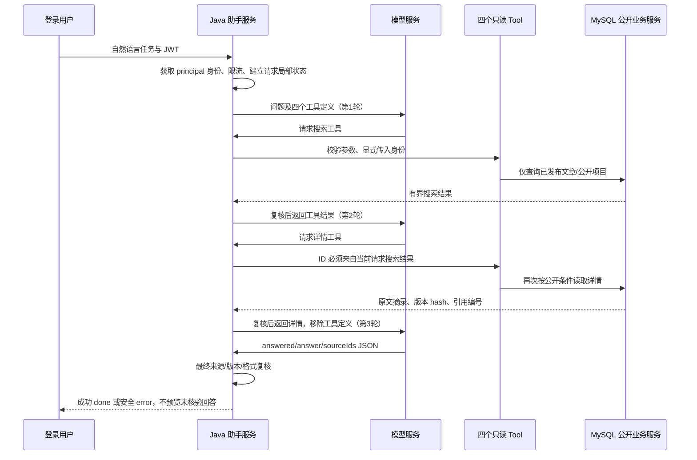

# Day11 执行与验收报告

日期：2026-10-04（Asia/Shanghai）。执行桌面《Yufeichi-AI应用构建与实习准备计划书》Day11：验证工具调用模型、受控单 Agent、显式身份、模型/工具/时间上限、真实 trace 和 10 条任务用例。没有改计划正文，没有提交、推送或上线。

## 基线与范围

分支 `codex/ai-assistant`，HEAD 保持 `6694f896472f346a5c4c0c2fd08ec6a1d087d890`。保留已有 Day7—Day10 未提交成果、原有 13 个文档删除及 `.vscode/extensions.json`；暂存区为空。Java 21.0.11、Spring Boot 3.5.16、Spring AI 1.1.8 保持不变。不修改 MySQL V1—V12、PG V1/V2，不连接线上服务，不执行数据库 clean/repair，不使用 skipTests。为解决实际空闲模型连接取消故障，POM仅新增Boot管理版本的reactor-netty-http，没有升级既有框架版本。

新增 `/ai/assistant` 登录页面，模型选择当前四个只读工具，服务器显式运行并整理带来源的回答。普通启用用户可用，无后台写权限要求；匿名开关不会放开助手接口。原固定关键词查询、摘要与 RAG 保留。

## 实际设计与安全边界



上图为实际验收路径，允许模型提前结束或在前两轮提出多个工具请求，工具由服务器顺序执行。服务器不根据用户问题硬编码先搜索哪类资料；它负责权限、参数、预算和来源边界。

| 约束 | 最终实现 |
|---|---|
| 模型请求 | 硬上限 3 轮，不使用 Spring AI 内部工具执行/隐式循环，无供应商自动重试 |
| 工具调用 | 硬上限 4 次，整批超出剩余额度时不执行该批；第三轮不执行工具 |
| 总时限 | AI_REQUEST_TIMEOUT_SECONDS，默认 60 秒，可配 1—120；包含调度、查询、模型与最终核对 |
| 模型配置 | 使用现有 Chat 环境变量；已验证 deepseek-flash；DeepSeek 助手固定非思考 reasoning_effort=none |
| 工具参数 | 沿用 Day10 四个 schema，真实入口检查类型/边界/额外字段/重复 JSON/尾随 JSON；模型参数错误按 AI_INVALID_RESPONSE 终止 |
| 详情访问 | 只能读取当前请求成功搜索的公开 ID，禁止猜 ID、写工具、任意 SQL/URL/文件工具 |
| 资料有效性 | 模型调用前、工具结果返回后、最终输出前核对公开状态、预览和全文 hash；变化时不交付答案 |
| 显式身份 | 从 JWT principal 取得，Prepared.userId → ToolContext.userId；不信任模型或 HTTP userId，不依赖异步线程中的 CurrentUser |
| 状态范围 | history、搜索匹配、详情、引用、工具 ID/调用去重、trace 与 usage 均属于本请求，无跨请求 Memory |
| 输出 | 严格 JSON 三字段，纯文本最多 1600 字符；来源只能来自真实详情，站内 URL/标题/hash由服务器创建 |
| 无答案 | 统一明确说明暂无站内依据，空来源；不能把模型外部知识写成站内事实 |
| 客户端停止 | 取消模型订阅、释放 AI 并发许可，离页/退出清理；不能保证撤销已开始的只读 SQL |
| 日志 | 只记 requestId、操作、结果类别、耗时；不保存任务/正文/工具参数/推理文本/密钥 |

工具错误、非法或未知调用、重复原样调用、超限、超时和模型故障都会结束本次执行，不发送成功 done。模型原始响应、异常和中间推理不对外展示。模型回复的 tool call ID 需合法且本请求唯一；引用仅来自详情，搜索预览本身不能作为回答引用。

入口共享现有用户 3 次/分钟、10 次/UTC 天和 AI 并发额度。入口保守预约第一轮全局付费预算，第二/三轮各预约一次；预算耗尽则不继续调用。预约次数不等于账单费用，失败/取消或未发出的预约不退款。只读助手不请求 Embedding、不需要 PG，不写业务记录或索引任务。

默认 `AI_AGENT_ENABLED=false` → `app.ai.agent-enabled`，需同时开启 AI_ENABLED、AI_TOOLS_ENABLED 并具备有效 Chat 配置。接口：GET `/api/ai/agent/status`；POST `/api/ai/agent/chat`，只接受 `{"question":"…"}`，1—500 字符。状态接口无付费调用。三开关关闭、账号禁用和匿名访问均按实际回归拒绝，核心网站仍可用。

建流前使用 HTTP 400/401/429/503；建流后用 error 事件记录安全业务码：63002 超时、63003 格式或工具违规、63004 执行上限、63005 来源变化、42900 配额。数据库故障不被当作正常无结果；日志和客户端不含原始异常。

## 修改范围与 diff 摘要

| 文件 | 本次作用 |
|---|---|
| 新增 AiToolModelGateway.java | 一轮模型请求的可测试接口，不执行工具 |
| SpringAiModelGateway.java、AiConfiguration.java、pom.xml | 沿用既有 Spring AI 模型；新增有界工具响应聚合；内部执行关闭；保留原摘要流式方法。为修复空闲上游取消，Chat WebClient改用独立、有界、Spring管理生命周期的Reactor Netty transport |
| 新增 AiAgentService.java | 显式循环、三类上限、请求局部状态、身份、来源复核、预算、JSON 与引用校验 |
| 新增 AgentRequest.java、AiAgentController.java | 严格任务 DTO、登录入口、SSE 生命周期、安全错误 |
| SiteReadToolCatalog.java | 复用四个工具，增加参数预检与显式 ToolContext 身份入口；工具 schema 无新增用户 ID 字段 |
| AiProperties.java、application.yml、application-test.yml、.env.example | 默认关闭开关；DeepSeek 非思考工具策略；测试不读真实模型配置 |
| ErrorCode.java | 新增执行上限、来源变化两个安全错误码 |
| 新增 AiAgentServiceTest.java、AiAgentIntegrationTests.java、SpringAiToolTransportTest.java、LiveAgentSmoke.java；AiConfigurationTest.java | 本次新增 32 个默认后端用例；独立 opt-in 真实模型 smoke；锁定非思考兼容策略；实际TCP连接取消负例 |
| 新增 src/api/agent.ts、views/front/AgentView.vue、tests/ai-agent.spec.ts | 有界 SSE 结果与来源检查、助手页、五项浏览器验收 |
| router/index.ts、ToolsView.vue、AiWorkspace.vue | 登录回跳及查询页/工作台入口 |
| scripts/ai-test-provider.mjs、scripts/test-web.mjs | 回环协议夹具（含分片 tool arguments、慢响应、写工具负例）；独立测试开关 |
| docs/ai/README.md、本报告、evidence/day11-agent-live.json、evidence/day11-task-cases.json | 功能说明、真实调用和十项回归证据 |

后端实现位于 `yufeichi-server/src/main/java/com/yufeichi/server/ai`，前端位于 `yufeichi-web`。当前 git diff 累计包含前几日尚未提交内容，不能将全部差异算作 Day11。没有新增 migration、修改业务 CRUD/权限结构或改生产配置。唯一新增运行依赖是Boot已管理的reactor-netty-http 1.2.18，用于实际模型HTTP取消，不引入Netty服务器或替换Tomcat。

## 实际模型证据

LiveAgentSmoke 两次各 **1 项通过，0 失败/跳过**：首次2026-10-04 02:29:10 +08:00，取消修复后的最终传输为03:01:49 +08:00。各次使用独立Testcontainers MySQL 8.4、Redis 7；只有Chat Key从本机受保护环境加载，未使用开发/生产账号或数据。测试文章明确是本地夹具，生产未写入。

任务：“请查询标题含 AgentComet 的文章，读取详情后告诉我构建标识。”真实 `deepseek-flash` 第 1 轮选择 searchArticles，第 2 轮选择 getArticleDetail，第 3 轮回答 **COMET-731**。来源为公开文章 `/articles/711`，hash与当前正文对应；私密草稿未进入回答或工具结果。

| 轮次 | 实际行为 | 供应商返回输入/输出 token |
|---|---|---|
| 1 | searchArticles，1 项公开匹配 | 1050 / 55 |
| 2 | getArticleDetail，1 项公开详情 | 1203 / 38 |
| 3 | 生成含 S1 的结构化回答，不提供工具定义 | 568 / 56 |
| 最终传输合计 | 3 次全局预约，2 次工具调用 | 2821 / 149 |

原始安全证据：[day11-agent-live.json](./evidence/day11-agent-live.json)，runs分别保存实际初版和最终传输结果。上表为最终传输；首版元数据为2822输入/156输出。本次真实验收合计 **6次全局预约、5643输入/305输出token元数据**。不能据这两次样本声称生产准确率、延迟分位数、并发能力或求职经历。未伪造模型trace，未进行十次真实模型评测；供应商使用量是返回元数据，不是实际人民币账单。

DeepSeek工具路径固定非思考策略，初次smoke已使用相同none配置。浏览器回归发现取消故障后，更换Chat的异步transport，最终传输的独立真实smoke也通过。其他供应商、模型及思考工具模式尚未验证。思考工具需要回传 reasoning_content，本阶段不声称支持。

## 十条任务回归

十项是脚本化模型响应的自动回归，用于验证服务器行为，不等于真实模型理解/效果评测；每项保存实际成功结果或安全错误码。证据：[day11-task-cases.json](./evidence/day11-task-cases.json)。

| 用例 | 预期与已验证行为 |
|---|---|
| 文章 | 搜索 → 详情 → 引用文章事实 |
| 项目 | 搜索 → 详情 → 引用项目事实 |
| 两类内容 | 两次搜索、两次详情，恰好四工具/三轮，可返回两类来源 |
| 无匹配 | 返回无答案、无来源 |
| 私密草稿 | 无公开搜索匹配，猜私密 ID 终止 |
| 通配符参数 | 模型提出非法关键词，拒绝执行 |
| 猜 ID | 未搜索就请求详情，拒绝执行 |
| 伪造引用 | 未实际读取的 S99 被拒绝，不返回答案 |
| 写入请求 | deleteArticle 不在允许集，终止、不修改数据 |
| 越界 URL 工具 | fetchUrl 不在允许集，终止、不请求外链 |

另覆盖重复调用/ID、超额整批、第三轮继续工具、来源下架和改文、最后模型期间变化、不同用户和不同请求状态、供应商错误不重试、总时限取消、客户端取消、三开关、旧 Token、身份参数注入、全局预算。浏览器协议夹具走实际 Spring AI transport，并将工具参数分成两个 SSE 片段，验证参数聚合及 callback 执行。

## 最终验证

| 检查 | 结果与记录 |
|---|---|
| Maven/JDK 与产物 | Maven 3.9.16 实际运行于 Java 21.0.11；`ai-day11-java21.log`；JAR 为 `yufeichi-server/target/yufeichi-server-0.0.1-SNAPSHOT.jar` |
| 完整后端 | **225通过，0失败/错误/跳过**；`ai-day11-cancel-final-full.log`，2026-10-04 03:08:20 +08:00完成 |
| 前端单元 | 6 通过，0 失败/跳过；`ai-day11-web-unit.log` |
| 前端类型检查/生产构建 | 通过；`ai-day11-final-web-build.log`；保留既有大包提示，不擅自重构 |
| 浏览器完整回归 | **45通过，0失败/跳过**；`ai-day11-cancel-final-browser.log`；包含5项助手测试，真实空闲上游取消、参数分片、来源链接、无答案、越界调用、登录回跳及原业务 |
| 真实模型 | 两次各1通过；`ai-day11-live.log`、`ai-day11-live-final.log`；合计6次预约，每次两工具，无Embedding |
| 密钥/迁移/diff/暂存区 | 实际本机API Key、私有Embedding URL、私钥头在变更源码/文档、dist、JAR应用类和本次日志中均未检出；迁移区域无跟踪差异；Java/Boot/AI版本保持，POM仅新增明确的transport依赖；diff --check通过、暂存区空、HEAD不变 |

实际命令：

```powershell
.\scripts\mvn21.ps1 '-Dtest=AiAgentServiceTest,SiteReadToolsTest,AiConfigurationTest' test
.\scripts\mvn21.ps1 '-Dtest=AiAgentIntegrationTests,AiAgentServiceTest' test
.\scripts\mvn21.ps1 '-Dtest=SpringAiToolTransportTest,AiConfigurationTest,AiAgentServiceTest' test
.\scripts\mvn21.ps1 clean verify
pnpm --dir yufeichi-web test:unit
pnpm --dir yufeichi-web build
$env:E2E_AI='1'; $env:E2E_PREVIEW='1'; node scripts/test-web.mjs
# 真实 smoke 单独启用，从受保护本机环境加载 Chat 配置，命令中不写 Key。
$env:AI_AGENT_SMOKE_ENABLED='true'
.\scripts\mvn21.ps1 '-Dtest=LiveAgentSmoke' test
git diff --check
git diff --cached --name-only
```

Maven 脚本自行退出 shell，各条分开执行。初始编译发现 ToolResponseMessage 构造器不可直接调用，以及 Container 通配导入冲突；已使用锁定版本 builder 和明确导入修复。真实调用前的编译失败没有发起模型请求。针对官方思考工具协议补齐DeepSeek专用策略后，224项完整回归通过。浏览器44通过、1失败：服务层CANCEL已经发生，但JDK WebClient在本次空闲响应场景未及时关闭上游连接。新增实际TCP取消用例、切换有界Reactor Netty传输后专项通过；原先POM没有该运行依赖（本机缓存有Jar不等于项目依赖），所以明确新增Boot管理的依赖。最终225项后端、45项浏览器及最终传输真实模型全部通过，没有放宽取消断言或隐藏失败。

## 完成标准与剩余阶段

**Day11达到本地开发验收标准。**

- [x] 至少一条真实模型 search → detail → answer 路径，实际来源正确，trace有证据。
- [x] 最多3轮模型、4次工具、受控总时限；错误/超限终止，无隐式工具循环或供应商重试。
- [x] 显式认证身份，普通账号仅查公开资料，匿名和禁用用户旧Token无法启动。
- [x] 详情只能来自当前请求搜索结果，参数/来源/hash校验及内容变化复核。
- [x] 十条任务回归，证据明确区分真实模型和脚本化响应。
- [x] 客户端取消释放许可及实际上游连接；离页清空，无跨请求状态。
- [x] 完整后端、浏览器、前端构建和既有功能回归通过。
- [x] 密钥/迁移/Git检查通过，原有删除/.vscode保留，未提交/推送/上线。

本次未提交、推送、上线，功能默认关闭；生产仍为 Day1—Day6。Day12 组合故障验收、Day13 真实质量评测、Day14 SSE代理/部署预演和正式发布仍按原计划执行；上线前需将新助手路径纳入 Nginx SSE 正式验收。现有四工具仅只读，无多 Agent、长期记忆、插件平台或模型训练。

引用允许集、hash 和权限能验证“来源来自当前公开内容”，不能机械保证模型每个事实受正文支持，也不能宣称抵抗所有正文提示注入；自动负例证明的是无写工具、无任意 URL 能力及私密资料边界。语义正确性、复杂任务成功率与性能数字留待真实评测。

官方依据：[Spring AI1.1 Tool Calling](https://docs.spring.io/spring-ai/reference/1.1/api/tools.html)、[锁定1.1.8模型实现](https://github.com/spring-projects/spring-ai/blob/v1.1.8/models/spring-ai-openai/src/main/java/org/springframework/ai/openai/OpenAiChatModel.java)、[DeepSeek Tool Calls](https://api-docs.deepseek.com/guides/tool_calls/)、[DeepSeek思考工具协议](https://api-docs.deepseek.com/guides/thinking_mode/)，查询2026-10-04。以本项目编译、实际请求和测试结果为准，未升级框架。

传输资源配置依据[Spring WebClient资源与超时官方说明](https://docs.spring.io/spring-framework/reference/web/webflux-webclient/client-builder.html)，查询2026-10-04；构造器与资源生命周期以锁定Spring6.2.19编译和实际TCP取消测试为准。
