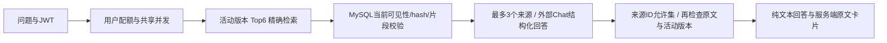

# Yufeichi AI：Day1—Day14 开发与交付说明

已实现受文章管理权限保护的摘要 API/SSE、编辑页预览与人工采用，以及 `/admin/ai` 摘要工作台。另提供独立Embedding/pgvector和管理员手动重建站内内容索引。Day7新增站内RAG问答，Day8增加默认关闭的匿名开关和安全复核，Day9增加自动索引同步，Day10增加四个只读工具和固定关键词查询页面，Day11增加模型选择工具的受控只读助手；线上已发布范围仍为Day1—Day6。

## 运行基线

- Java 21（本次 Maven 实测 21.0.11）；Spring Boot 3.5.16；Spring AI BOM 1.1.8。
- Maven 在 `yufeichi-server` 模块运行，Windows 入口为根目录 `scripts/mvn21.ps1`。
- 实际 JAR：`yufeichi-server/target/yufeichi-server-0.0.1-SNAPSHOT.jar`。
- 后端保持 Spring MVC/Tomcat；Chat流式WebClient使用独立有界Reactor Netty，取消关闭上游；同步HTTP使用Java21客户端，不切换Web服务器。
- MySQL/Redis 使用原配置，V1—V11 migration不变；PostgreSQL采用独立连接池和独立向量迁移，不替换业务数据源。
- Day6只新增MySQL V11索引状态/任务表，以及PG V2版本查询索引，既有迁移不变。
- `AI_ENABLED=false` 为默认值。关闭时不创建模型或 HTTP 客户端，不要求 API Key/模型地址，也不尝试外部网络调用。
- 即使开关为 true，地址、Key、模型名不完整时也不创建模型传输；核心应用仍可启动，摘要接口返回503。完整但不安全的URL或无效限额会被配置校验拒绝。

## 已实现接口

两个接口均要求有效 JWT，且拥有 `article:add` 或 `article:update`。当前权限是 V1.0 的全站内容管理权限，并非作者行权限。

| 接口 | 内容与响应 |
|---|---|
| `POST /api/admin/ai/summary` | JSON `{"content":"当前正文"}`；成功返回原 `Result<SummaryResponse>` |
| `POST /api/admin/ai/summary/stream` | 同一输入；POST SSE；认证、参数、开关、配额错误在建流前返回 HTTP 错误 |

`SummaryResponse` 包含 `summary`、`contentHash` 和 `requestId`。`contentHash` 是原始输入 UTF-8 的 SHA-256；摘要接口不写入数据库。页面核对正文快照和hash，只有生成完成、正文未变化时才能采用；文章仍由用户手动保存。

输入默认最多 12000 个 Java/JavaScript 字符单位，服务端 DTO 硬上限 20000；输出最多 500，符合现有摘要字段。JSON 模式检查字段类型、长度、额外字段、重复字段和尾随数据；流式输出收到供应商有效结束标记并完成校验后才发送 `done`。

## SSE 协议

每个事件以空行分隔；`data` 为 JSON，不能将它当普通 `Result<T>` 的多次响应。

| 事件 | `data` | 行为 |
|---|---|---|
| `meta` | `requestId/contentHash/mode/sources` | 首帧，`mode=article-summary`；`sources=[]`，不伪装成来源问答 |
| `delta` | `{"text":"摘要片段"}` | 可临时展示，但未完成时不能标记成功或自动采用 |
| `heartbeat` | `requestId` | 保持链路和检测断开，默认每 10 秒 |
| `done` | `SummaryResponse` | 校验后的完整结果；客户端结束读取 |
| `error` | 安全 `Result` 错误码和消息 | 已建流后的失败；不存在后续 `done`，不得显示“生成完成” |

前端 `src/api/ai.ts` 提供 `generateSummary`、`streamSummary` 和 `cancelAiRequests`，通过独立 `fetch` 实现 65 秒客户端总时限。支持外部 `AbortSignal`；摘要面板在正文变化、停止和组件卸载时取消。浏览器离开页面、用户退出或清理登录状态也会取消请求。Token 只在 Authorization Header 中传输，不能放入 URL。

`src/api/sse.ts` 使用流式 UTF-8 解码、SSE 帧解析和 reader 取消，覆盖 CRLF 跨包、中文跨字节、多帧合包、半帧 EOF 和超大事件。

## 配置映射

变量显式映射至 `application.yml` 的 `app.ai.*`，不是供应商自动识别的环境变量。`.env.example` 只是模板，Java 不自动加载 `.env`。

| 环境变量 | 应用属性 | 默认值 |
|---|---|---|
| `AI_ENABLED` | `enabled` | false |
| `AI_KNOWLEDGE_ENABLED` | `knowledge-enabled` | false；需AI/向量/模型均已配置 |
| `AI_KNOWLEDGE_TOP_K` | `knowledge-top-k` | 6；范围1—10，Day13比较3和5 |
| `AI_PROVIDER_BASE_URL` | `base-url` | 空；启用时必填 |
| `AI_COMPLETIONS_PATH` | `completions-path` | `/v1/chat/completions` |
| `AI_API_KEY` | `api-key` | 空；仅后端 |
| `AI_CHAT_MODEL` | `chat-model` | 空；启用时必填 |
| `AI_JSON_MODE` | `json-mode` | true；是否向兼容 API 请求 json_object |
| `AI_REASONING_EFFORT` | `reasoning-effort` | 空；官方 `api.deepseek.com` 自动使用 `none`，其他供应商不发送该字段；显式值优先 |
| `AI_REQUEST_TIMEOUT_SECONDS` | `request-timeout-seconds` | 60，包含重试的整条生成时限 |
| `AI_INDEX_TIMEOUT_SECONDS` | `index-timeout-seconds` | 300，1—300；跨过时限的批次不得激活索引 |
| `AI_CONNECT_TIMEOUT_SECONDS` | `connect-timeout-seconds` | 5 |
| `AI_HEARTBEAT_SECONDS` | `heartbeat-seconds` | 10 |
| `AI_MAX_OUTPUT_TOKENS` | `max-output-tokens` | 800 |
| `AI_MAX_INPUT_CHARS` | `max-input-chars` | 12000 |
| `AI_MAX_CONCURRENT_REQUESTS` | `max-concurrent-requests` | 2，同一 JVM |
| `AI_USER_MINUTE_LIMIT` | `user-minute-limit` | 3 |
| `AI_USER_DAILY_LIMIT` | `user-daily-limit` | 10 |
| `AI_DAILY_REQUEST_LIMIT` | `daily-request-limit` | 100，全局含重试 |
| `AI_EMBEDDING_BASE_URL` | `embedding.base-url` | 空；与Chat独立 |
| `AI_EMBEDDING_API_KEY` | `embedding.api-key` | 空；仅后端 |
| `AI_EMBEDDING_MODEL` | `embedding.model` | 空 |
| `AI_EMBEDDING_DIMENSIONS` | `embedding.dimensions` | 1024；与实际返回和库列一致 |
| `AI_EMBEDDING_PATH` | `embedding.path` | 空；基础地址末尾/v1时追加/embeddings，否则/v1/embeddings |
| `AI_VECTOR_ENABLED` | `vector.enabled` | false；需同时AI_ENABLED=true |
| `AI_VECTOR_URL` | `vector.url` | 空；独立jdbc:postgresql://地址 |
| `AI_VECTOR_USERNAME` | `vector.username` | 空；独立PG账号 |
| `AI_VECTOR_PASSWORD` | `vector.password` | 空；不得进入URL、前端或Git |

配置 URL 应是服务商 origin 或经验证的基础路径；完整补全路径由 `AI_COMPLETIONS_PATH` 明确提供，避免重复 `/v1`。只接受 HTTPS；本机 loopback HTTP 为隔离测试保留。不接受用户请求指定 URL、模型或 Key。

当前适配器使用 OpenAI 兼容协议，但没有认定所有服务商都兼容。需要真实验证 JSON、SSE、结束原因与认证。即使关闭 json_object 选项，返回内容仍必须符合 JSON 结构校验。暂未提供多供应商路由。

## 配额、故障与日志

- Redis `ai:*` 使用原子 Lua 预留用户/全局计数，与原 `security:*` 隔离。每日配额按 UTC 日期；分钟窗口从首次计数开始，约 60 秒。
- 失败尝试也消耗请求配额，不自动退还。瞬态 502/503/504 或连接故障在尚未收到任何片段时最多重试 1 次，另占全局额度；401/400/429不重试。
- 输出以后不重放。供应商 429 可能是账户额度不足，不能误当成用户登录失败。
- AI 并发、线程、HTTP 执行队列有界；超时、取消、错误和完成释放许可。单 JVM 并发数不等于多实例分布式并发数，扩实例前需要额外设计。
- Redis 配额失败时 AI 拒绝新付费调用。公开文章/项目查询延续原行为；原认证本身仍按 V1.0 依赖 Redis，不能宣称 Redis 故障时所有旧功能都不受影响。
- AI HTTP 错误：参数 400、未认证 401、权限 403、配额/并发 429、模型配置或供应商故障 503、总超时 504、无效模型结果 502。
- SSE 开始后用 `error` 事件传递失败，不能改变已经发出的 200。安全链允许容器 ASYNC 完成分派，原 REQUEST 的 JWT/权限检查仍然执行。
- 只记录请求 ID、操作、结果与耗时。供应商异常消息/正文被丢弃，模型库的可能包含 Prompt 的日志被关闭。API Key、JWT 和正文不得进入日志或前端。
- 尚未实现人民币账单硬上限；请求数/输入/输出限制是目前的控制手段。发布前核对真实价格与账户预算，不把请求配额宣称为精确费用控制。

## 隔离验收命令

从仓库根目录执行：

```powershell
.\scripts\mvn21.ps1 -version
.\scripts\mvn21.ps1 clean verify
pnpm --dir yufeichi-web install --frozen-lockfile
pnpm --dir yufeichi-web test:unit
pnpm --dir yufeichi-web build
$env:E2E_AI = '1'
$env:E2E_PREVIEW = '1'
node scripts/test-web.mjs
Remove-Item Env:E2E_AI
Remove-Item Env:E2E_PREVIEW
```

后端与浏览器均使用新建的 MySQL 8.4/Redis 7 临时容器及随机端口，不接受开发/生产库作为替代。向量集成测试另建独立PG容器。模型桩仅监听loopback；协议专项注入实际模块，Day4页面专项直接操作构建后的编辑页与AI工作台。HTTP错误模拟用例明确标记。

默认构建不执行真实模型或产生 API 费用。真实 smoke 类 `LiveAiSmoke` 不匹配 Surefire 默认测试命名，只有显式 `-Dtest=LiveAiSmoke` 才执行，并额外要求 `AI_SMOKE_ENABLED=true`。

真实验收在安全设置所有模型环境变量后执行：

```powershell
# 仅在明确启用少量真实调用、已核对供应商价格后运行；不要把 Key 写入命令或文档。
$env:AI_SMOKE_ENABLED = 'true'
.\scripts\mvn21.ps1 '-Dtest=LiveAiSmoke' test
Remove-Item Env:AI_SMOKE_ENABLED
```

`LiveAiSmoke`验证普通Chat、结构化输出、SSE、Embedding各一次，不自动重试。Embedding另需独立环境变量，路径可用AI_EMBEDDING_PATH指定。该smoke仅验证模型能力；`LiveVectorSmoke`另验证Day5向量闭环。Tool Calling真实验证另见Day11的LiveAgentSmoke及Day14三场景演示。

已在2026-09-30通过Spring AI实际验证：DeepSeek官方 `deepseek-flash`（`https://api.deepseek.com`）与北京百炼 `qwen3.7-text-embedding-flash`、1024维。百炼基础地址使用用户自己的业务空间地址，保存在后端环境变量中，不在仓库记录。该地址已包含 `/compatible-mode/v1`，smoke默认只追加 `/embeddings`，显式请求1024维及float编码。

Windows用户环境变量不会自动进入已经打开的终端。重新打开终端，或在当前验收进程内加载；以下示例不会输出Key，也不修改用户或系统的持久配置：

```powershell
$aiNames = @('AI_PROVIDER_BASE_URL','AI_CHAT_MODEL','AI_API_KEY',
  'AI_EMBEDDING_BASE_URL','AI_EMBEDDING_MODEL','AI_EMBEDDING_DIMENSIONS','AI_EMBEDDING_API_KEY')
foreach ($aiName in $aiNames) {
  if ([string]::IsNullOrWhiteSpace([Environment]::GetEnvironmentVariable($aiName,'Process'))) {
    $aiValue = [Environment]::GetEnvironmentVariable($aiName,'User')
    if (-not [string]::IsNullOrWhiteSpace($aiValue)) {
      [Environment]::SetEnvironmentVariable($aiName,$aiValue,'Process')
    }
  }
}
$env:AI_SMOKE_ENABLED = 'true'
.\scripts\mvn21.ps1 '-Dtest=LiveAiSmoke' test
```

网站真实模型验收有独立开关，默认浏览器测试不会执行它。先完成后端打包与前端build，再使用已经加载Chat环境变量的终端运行：

```powershell
$env:E2E_AI_LIVE = '1'
$env:E2E_PREVIEW = '1'
node scripts/test-web.mjs ai-live.spec.ts
Remove-Item Env:E2E_AI_LIVE
Remove-Item Env:E2E_PREVIEW
```

该入口创建独立MySQL/Redis，启用真正的Java摘要接口，浏览器调用实际前端模块，共发起4条短Chat请求（JSON、SSE、取消、取消后JSON）；全局配额4包含可能的重试。只发送明确标记的公开验收正文。后端Key通过环境变量占位符读取，Vite/Playwright进程会移除所有 `AI_*` 变量，真实模式关闭trace。取消可停止本地读取和请求；供应商是否立即停止推理及如何计费不由网站保证。

Day4真实页面验收改用 `node scripts/test-web.mjs ai-editor-live.spec.ts`，只发起1条Chat，直接检查编辑页预览、人工采用、手动保存草稿；两种专项入口的调用数分别记录。

## 页面与向量运行

- 文章编辑页新增摘要面板；空正文/超长/生成中禁止发起新请求，停止或失败的半段摘要不可采用。
- 正文变化会使旧候选失效，即使改回原正文也需重新生成。已有人工摘要采用前确认替换，确认期间正文变化也不能覆盖。
- `/admin/ai`是当前可用的摘要工作台，只允许article:add/update权限。当前输入限12000字符，仅保存在页面内存，离开清空，不建立长期记忆或聊天历史。
- 前台导航与内容工作台提供入口；匿名用户先登录，无权限返回403。AI关闭时显示明确失败，不影响原编辑和保存。
- AI候选复用原MarkdownContent净化组件，不使用未经净化的HTML。

向量镜像固定为 `pgvector/pgvector:0.8.6-pg17@sha256:cf134a767f474095eeba57e0117be8e568e011a63f33fbf252f14c9b760f8e6f`，本机验证PG17.11/pgvector0.8.6。独立Compose文件 `deploy/ai/compose.yml` 只监听127.0.0.1，默认15432、512MiB内存/0.5 CPU配置，采用独立持久卷和pg_isready健康检查。该资源配置不是已证明的生产容量。

本地验证使用临时容器，运行结束清理。本地长期运行时，使用Git忽略的 `deploy/ai/.env` 或当前进程环境提供独立AI_VECTOR_PASSWORD，再执行：

```powershell
# 先安全配置独立PG密码，不要在命令正文填写或打印密码。
docker compose -f deploy/ai/compose.yml up -d --wait
# 若密码在Git忽略的deploy/ai/.env文件中，明确指定文件：
# docker compose --env-file deploy/ai/.env -f deploy/ai/compose.yml up -d --wait
# 临时项目验证无需密码/模型Key；仅创建、清理脚本拥有的随机项目。
node scripts/test-vector-compose.mjs
```

Java后端另需 `AI_ENABLED=true`、`AI_VECTOR_ENABLED=true`、`AI_VECTOR_URL=jdbc:postgresql://127.0.0.1:15432/yufeichi_ai`、`AI_VECTOR_USERNAME=ai_vector`、独立PG密码与Embedding变量。Compose变量不会自动成为Java环境变量；可按其启动方式从受保护配置加载，不写进Git。若使用.env文件，Compose路径为deploy/ai，Java仍不自动读取它。

`AiVectorStore`内部管理独立Hikari池（最多2连接），不注册第二个DataSource/JdbcTemplate/Flyway Bean，不影响MyBatis和MySQL Flyway自动配置。构造不连接PG；首次显式initialize/add/search时独立Flyway校验并执行 `db/vector/migration`，记录在 `yufeichi_ai.vector_schema_history`。禁用clean/repair、禁止自动覆盖表；模型名、实际返回维度、profile记录与vector列类型必须一致。变更模型/维度需未来的独立索引版本，不能静默复用旧库。

当前选择cosine精确检索、PgIndexType.NONE，无HNSW。Embedding固定float编码，输入每批最多20条，每条受长度上限约束；响应条数、顺序、维度、有限数值与非零向量均校验。后台提供手动索引入口，内部search组件仍不可直接对外开放。

## Day6 内容索引

`GET /api/admin/ai/knowledge`返回开关、当前版本和最近20个任务；`POST /api/admin/ai/knowledge/reindex`提交任务。二者都要求JWT和现有`super_admin`角色。后台AI页面有重建按钮、处理中状态和安全失败原因，普通作者无法访问任务记录。

只读取`status=1 AND deleted=0`的文章和项目。文章取标题/摘要/正文，项目取名称/说明/技术栈，不读取账号、作者信息或请求指定URL。按段落合并为最多1024字符的片段，长段按Unicode边界拆开；本轮限制100片段/任务。metadata包括服务端生成的站内链接、sourceType/sourceId、SHA256内容hash、indexVersion、片段序号、分段策略、模型和维度。

MySQL V11持久化任务和活动版本，单一待处理任务；专属后台线程通过MySQL连接锁防止多个进程重复调用。外部模型不在业务事务内运行。每批20片段只对应一次Embedding请求，共享Chat并发和全局日配额，另加UTC每日10批/100000字符上限；失败也计入预算。Day9自动任务允许最多3次总尝试，所有尝试均受这些预算限制。任务时限300秒，单次HTTP最多60秒，边界检查会在当前有界调用结束后生效。

完整新版本写入、片段ID/正文/metadata验证、事务内重读公开来源并确认hash未变后才切换活动指针。相同内容完整重建复用版本、不新增片段、不调用Embedding；新版本或模型失败保留旧指针。崩溃中的RUNNING任务在数据库连接锁释放后的下一次轮询标为INTERRUPTED，排队任务重新启动后继续处理。Day9会清理可验证归属的过期片段；任务记录保留诊断信息，不保证旧向量版本可立即回退。

空公开内容允许建立空索引而不调用模型。内容修改/下架/删除后的自动同步与旧版本清理已在Day9实现（独立开关，默认关闭）；检索必须限定活动indexVersion并实时校验来源，不可直接使用旧向量。模型/维度变更仍须独立schema/存储空间，当前明确拒绝在旧向量空间静默换模型。

生产配置见`deploy/production/ai-compose.yml`及`configure-ai.py`：独立PG持久卷、回环端口、受保护secret与backend.env。每日正式备份包含PG SQL并校验哈希；应用回退保留已应用的V11/V12和PG卷，不能运行clean/repair/down -v。SSE使用单独Nginx location，关闭缓冲、130秒读时限，原业务API配置保持原值。

真实向量验收使用新建临时PG，只调用两次Embedding（2条公开文本一批写入、1条查询），不调用Chat：

```powershell
# 先为本进程加载已有Embedding变量；默认完整构建不会运行此类。
$env:AI_SMOKE_ENABLED='true'
.\scripts\mvn21.ps1 '-Dtest=LiveVectorSmoke' test
```

当日公开价格参考：DeepSeek Flash每百万token峰值输入缓存未命中$0.30、命中$0.006、输出$1.20，非高峰半价；北京Embedding每千输入token0.000125元。以1000输入、800输出token的摘要估算，按峰值未命中约$0.00126/次，这是测算而非本次账单。请求数量上限不是人民币硬上限；账户剩余额度、优惠和服务商侧预算策略需在后续发布前核对。[DeepSeek价格](https://api-docs.deepseek.com/quick_start/pricing/)、[百炼Embedding接口及价格](https://help.aliyun.com/zh/model-studio/text-embedding-synchronous-api/)。

## 官方依据

查询日期：2026-09-30。Spring AI 官方稳定版本列表仍列出 1.1.8；未使用 1.1.9-SNAPSHOT 或 2.x。

- [稳定版本列表](https://docs.spring.io/spring-ai/reference/spring-projects.html)
- [1.1.8 发布记录](https://spring.io/blog/2026/06/12/spring-ai-1-1-8-1-0-9-avaialble-now/)
- [1.1.8 OpenAiChatModel 源码](https://github.com/spring-projects/spring-ai/blob/v1.1.8/models/spring-ai-openai/src/main/java/org/springframework/ai/openai/OpenAiChatModel.java)
- [1.1.8 OpenAiApi 源码](https://github.com/spring-projects/spring-ai/blob/v1.1.8/models/spring-ai-openai/src/main/java/org/springframework/ai/openai/api/OpenAiApi.java)
- [DeepSeek Chat协议：reasoning_effort与JSON/SSE](https://api-docs.deepseek.com/api/create-chat-completion/)
- [pgvector官方版本、精确检索与Docker](https://github.com/pgvector/pgvector)
- [Spring AI 1.1.8 PgVectorStore实现](https://github.com/spring-projects/spring-ai/blob/v1.1.8/vector-stores/spring-ai-pgvector-store/src/main/java/org/springframework/ai/vectorstore/pgvector/PgVectorStore.java)

本地模型桩证明接口与工程行为，不证明真实供应商质量、价格、可达性或 Embedding 维度。真实模型记录见本阶段执行报告。

- [Day1—Day3报告](./Day1-Day3-执行与验收报告.md)
- [Day4—Day5报告](./Day4-Day5-执行与验收报告.md)

## Day7：带来源的站内问答

页面`/ai/knowledge`，接口`POST /api/ai/knowledge/chat`，请求`{"question":"问题"}`，最多500字符。任何启用的登录用户都可查询公开内容，不要求文章管理权限；匿名默认401，仅在AI_PUBLIC_ENABLED=true时允许。SecurityConfig只放开精确POST问答路径，其他AI/后台接口保留认证权限。GET /api/ai/knowledge/status仅公开available/publicEnabled/loginRequired，不公开内容、模型配置或索引记录。

启用需要同时`AI_ENABLED=true`、`AI_KNOWLEDGE_ENABLED=true`、`AI_VECTOR_ENABLED=true`，Chat/Embedding与独立PG配置齐全，并在`/admin/ai`由super_admin重建索引。既有MySQL与PG migration不修改，Day9新增MySQL V12。若无活动索引或活动索引为空，直接返回无依据，不调用模型；已改文/下架的旧片段也不送Chat。AI_INDEX_SYNC_ENABLED=true时自动同步，管理员也可以手动重建。



余弦相似度阈值默认0.5（AI_KNOWLEDGE_SIMILARITY_THRESHOLD，范围大于0且不超过1）、TopK6；最多3个来源、6段，每段最多1024字符。阈值是首版策略，需后续真实站内内容评测，不能把相似度当答案可靠概率。相近但不支持问题的材料由模型返回answered=false；服务器统一显示“站内暂无足够依据…”。模型只输出answered/answer/sourceIds，严格JSON、回答最多1600字符。来源只允许本次通过校验的S1—S3；网址和标题来自当前MySQL原文，拒绝模型URL/HTML/伪造ID。来源存在不保证每个事实正确，仍需人工与Day13评测。

SSE固定meta/heartbeat/delta/sources/done/error，先发meta/心跳；模型回答先在后端缓冲，完成JSON和来源复核后才发delta/sources/done。这是经过校验后分段交付，不能表述为逐token实时预览。前端仅在完整done且协议、来源、正文一致时展示结果，纯文本插值避免未校验链接。停止、离页、退出登录均取消；输入与最后一条结果只在内存中，刷新清空，无会话数据库。页面可匿名打开；匿名关闭时需点击登录后提问，AI不可用时保留文章入口。

匿名按ClientAddress解析的可信IP限制3次/分钟、10次/UTC天（Redis键仅存哈希），共用100次/UTC天供应商请求预算和并发2。只有配置的直连代理才可以提供X-Real-IP；现有Nginx覆盖该头为remote_addr，其他来源的伪造头被忽略。已登录用户沿用用户配额。问答共用摘要/索引并发和Redis配额，整体请求默认60秒，客户端65秒。查询Embedding计一次全局请求，有候选时Chat再计一次；每次问题计一次用户配额，付费失败也占用。没有自动重试，最多两个供应商调用；空索引不付费，但保守占用一次全局预约。Redis不可用不发付费请求。日志不保存问题、资料或模型原始响应。

Nginx模板新增此接口独立无缓冲location，部署时须安装并实测；本次没有改变生产配置或发布Day7。真实验收显式启用LiveRagSmoke：独立MySQL/Redis/PG，一批公开测试片段、两个问题，最多5次付费请求，不读取开发或生产业务数据。

依据：[Spring AI PgVector检索与metadata filter官方文档](https://docs.spring.io/spring-ai/reference/api/vectordbs/pgvector.html)，查询2026-10-02；实际API以锁定1.1.8的编译与集成结果为准。结果与限制见[Day7报告](./Day7-执行与验收报告.md)。


## Day8—Day9：可见性边界与提交后同步

| 环境变量 | 属性 | 默认 |
|---|---|---|
| AI_PUBLIC_ENABLED | app.ai.public-enabled | false，匿名问答需明确开启 |
| AI_INDEX_SYNC_ENABLED | app.ai.index-sync-enabled | false，后台自动同步需明确开启 |
| AI_INDEX_RETRY_DELAY_SECONDS | app.ai.index-retry-delay-seconds | 60，范围1—300；失败退避60/120秒后再尝试 |

只有业务事务成功提交的公开内容变更才发送同步信号。监听器使用REQUIRES_NEW短事务记录V12的generation；回滚不产生任务，记录失败不改变已提交的业务结果。2秒防抖合并连续改动，后台每2秒检查持久队列，模型调用和PG写入不进入MySQL业务事务。任务记录origin=MANUAL/AUTO，系统自动任务requested_by=0（无用户外键，不冒用管理员身份）。

本轮在最多100片段的小型语料范围内采用公开快照重建。来源类型/ID/hash组成manifest；片段ID包含版本、类型、ID/hash/序号，重复任务不会重复入库。完全相同且校验通过的版本不调用Embedding；改动后新版本完整校验才激活。构建期间的新generation不被旧任务覆盖；业务变化会使旧任务失败并继续同步最新快照。

每个待同步generation最多3次总尝试（含第一次），持久化失败数、下次时间与安全错误码；SOURCE_CHANGED、网络/依赖错误等有限退避重试。INPUT_LIMIT和QUOTA立即暂停，避免重复无效/付费请求。新公开内容变更或管理员手动重建恢复尝试。后台显示待同步/失败/暂停状态。持续编辑可能延后防抖任务，公开内容本身依然按当前MySQL状态提供。

每5分钟对账一次公开manifest（首次启用立即检查），补偿提交后信号漏记、关闭期间变化和进程重启间隙；不替代实时权限检查。排队任务持久化恢复，崩溃残留RUNNING标为INTERRUPTED并按剩余次数恢复；连接锁避免多个后台实例重复执行模型任务。

清理只删除可由确定性ID与完整metadata验证为本系统创建、且版本过期或来源已隐藏/删除/hash改变的行，每批最多20条。扫描每轮最多1000行并轮转分页；foreign、未知归属、被篡改无法验证归属的数据保留，不执行TRUNCATE/clean/repair。未变化公开来源在构建失败时保留活动指针和片段，变化来源的旧片段可以先清理。清理故障会记录安全提示并在对账时重试；问答仍以MySQL当前状态阻断旧内容。

所有检索上下文在发送Chat前和返回回答前都复核当前公开状态、hash、片段与活动版本，包含未被模型引用的资料。模型无任何工具定义或写能力；问题/文章内的指令作为不可信材料，严格JSON和来源允许集限制输出。提示词防御不等于所有提示注入均已被证明安全；更完整质量与故障评测按后续阶段执行。

验证与边界见[Day8—Day9执行报告](./Day8-Day9-执行与验收报告.md)。生产仍为Day1—Day6，本次不改变线上开关或服务。


## Day10：只读工具与固定查询

页面`/ai/tools`要求有效登录，普通启用账号也可使用；AI工作台和站内问答页均有入口。`GET /api/ai/tools/status`只返回available，`POST /api/ai/tools/query`接收`{"keyword":"Java","scope":"ALL","limit":3}`；scope只允许ALL/ARTICLE/PROJECT，limit1—5。两个接口均要求JWT，RAG匿名开关不会放开工具接口。

`AI_TOOLS_ENABLED=false`映射`app.ai.tools-enabled`，需与`AI_ENABLED=true`共同开启。固定流程仅依赖已有MySQL与Redis，不要求Chat Key、Embedding服务或PG，不调用外部模型，不占付费供应商预算。Redis为查询用户限制10次/分钟、100次/UTC天，使用独立哈希键，共享AI并发上限；Redis失败时返回503并释放许可。

| 工具 | 输入 | 固定公开规则与返回 |
|---|---|---|
| searchArticles | keyword、limit | 复用ArticleService.list(publicOnly=true)，标题LIKE字面关键词，第一页最多5项；标题/预览各最多200字符 |
| getArticleDetail | id | 复用ArticleService.detail(publicOnly=true)，已发布且未删除；原文摘录最多2000字符、hash、截断标志和/articles/id |
| searchProjects | keyword、limit | 复用ProjectService.list(publicOnly=true)，名称LIKE字面关键词，第一页最多5项；不视为全文或语义检索 |
| getProjectDetail | id | 复用ProjectService.detail(publicOnly=true)，公开且未删除；说明/技术栈摘录、hash、截断标志和/projects/id |

关键词1—80字符，不接受%、_、反斜杠和控制字符；ID必须为1—9007199254740991整数。只允许既定字段，不接受publicOnly/status/SQL/URL控制参数；看起来像SQL或URL的普通关键词只作为查询值，不执行SQL或访问URL。隐藏、删除与不存在详情统一NOT_FOUND；数据库故障不伪装成无结果。输出不含作者ID、账号、管理状态、计数或外部项目链接。

Spring AI1.1.8的@Tool/@ToolParam生成四个MethodToolCallback，SiteReadToolCatalog在生成schema上增加数值/长度边界、additionalProperties=false，并在实际callback入口严格验证参数类型、额外字段、重复字段、尾随JSON及范围。直接调用Java工具方法也验证范围，不以模型遵守schema代替后端校验。没有注册写工具、SQL工具、任意URL工具，摘要/RAG仍不向模型提供这些工具。

固定Workflow按用户范围逐类搜索，读取每类首项，最多4个callback调用、2条详情。完成前复核当前公开预览与详情hash，内容变更时丢弃本次结果。复核是内部业务服务读取，不扩展可供模型使用的工具列表。返回mode=fixed-query、requestId、安全步骤名/结果数量和来源；步骤与请求结果仅存于当前请求，日志不记录关键词、正文、Token或原始callback参数。

页面每类展示最多3个匹配，摘录以纯文本展示，来源仅接受规范站内链接。支持明确无结果、功能关闭、停止和离页清空；取消浏览器请求不会撤销已开始的只读数据库查询。本阶段没有模型挑选工具、AI生成答案、多轮循环或长期记忆；真实Tool Calling与受控Agent留在Day11，不能将本阶段写成已完成Agent。

工具定义依据锁定版本[Spring AI1.1 Tool Calling官方文档](https://docs.spring.io/spring-ai/reference/1.1/api/tools.html)，查询2026-10-04。没有因当前最新版文档为2.x而升级项目。实际schema和流程证据见[Day10执行报告](./Day10-执行与验收报告.md)。

## Day11：受控只读助手

登录页面 `/ai/assistant` 接收自然语言任务，模型实际选择四个只读工具，服务器校验并执行，再将公开结果送回模型整理答案。普通启用账号可使用；`AI_PUBLIC_ENABLED`不会放开这个助手。`GET /api/ai/agent/status`返回available及上限；`POST /api/ai/agent/chat`接收`{"question":"查找Java文章，读取详情介绍构建标识"}`，question为1—500字符，只接受这个字段。

`AI_AGENT_ENABLED=false`映射`app.ai.agent-enabled`，必须与`AI_ENABLED=true`、`AI_TOOLS_ENABLED=true`共同开启且配置有效Chat服务。MySQL和Redis沿用已有业务环境；此助手不依赖Embedding或PG。API Key只在受保护后端环境加载。默认最多3轮模型请求、4次工具调用；总时限由`AI_REQUEST_TIMEOUT_SECONDS`控制，默认60秒、配置范围1—120秒，包括调度、业务查询、模型请求及最终复核。前端125秒兜底，客户端可随时停止；取消或超时终止模型订阅，但不保证撤销已经开始的只读SQL。

Spring AI内部工具执行关闭，模型不能触发隐式循环；每轮由AiAgentService明确执行。工具请求按Day10 schema及运行时检查验证，只允许四个名字；详情ID必须来自当前请求之前成功搜索得到的公开结果。工具异常、未知工具、非法参数、重复调用或超限会终止，不执行额外模型请求。不自动重试供应商调用。第三轮或四次工具额度用尽后不再向模型提供工具定义，只允许回答；违规继续请求工具时终止。

请求身份由JWT principal取得，显式存入Prepared并在工具调用的ToolContext中检查；不从模型参数、请求中的userId或异步线程的ThreadLocal取得身份。所有资料始终按publicOnly=true读取，不向模型发送用户ID、Token、账号或管理字段。对话、预览、详情、引用和步骤只存在本次请求，没有跨请求Memory。每轮调用前、工具返回后和最终回答前复核所有已收集公开资料，变化时整次结果丢弃。

最终模型JSON仅允许answered/answer/sourceIds，纯文本回答最多1600字符；引用只能来自实际读取的详情，网址、标题、ID和全文hash由服务器生成。无依据统一说明“站内暂无足够依据…”，不提供来源。引用有效不等于所有事实正确，Day13固定题集的真实效果评测已完成，见evaluation.md；不等于生产内容效果保证。本次不向客户端预览未经核验的模型片段，SSE只发送meta/heartbeat/done或error；只有done后展示回答与步骤。

| 错误 | 行为 |
|---|---|
| 未登录/禁用账号旧Token、请求参数错误、功能关闭、入口配额不足 | 建流前返回HTTP 401/400/503/429 |
| 63002 超时；63003 格式/工具违规；63004 执行上限；63005 来源变化；42900 全局预约不足 | 建流后发送安全error事件，不发送done；页面清空未完成结果 |
| 供应商故障、业务数据库故障 | 安全错误终止；数据库异常不伪装成普通无结果，不返回原始异常 |

共享现有AI用户3次/分钟、10次/UTC天和并发上限；入口预约第一轮全局付费预算，后续每轮单独预约，最多3次，无模型重试。预算计数是保守预约次数，不是实际人民币账单；如果预约后未能发起请求，也不退回计数。日志只记录requestId、操作、结果类别和耗时，不记任务、原文、工具参数、推理内容或密钥。返回usage为供应商各轮token元数据，未提供时为0占位，不能据此声称实际用量为0。

已真实验证`deepseek-flash`非思考模式的searchArticles → getArticleDetail → answer。DeepSeek助手工具调用固定reasoning_effort=none，避免思考工具协议要求额外reasoning_content回传；这不改变原摘要/RAG的reasoning配置。其他供应商模型、思考工具模式及生产部署尚未验收，不以接口兼容代替真实能力验证。依据[Spring AI1.1工具文档](https://docs.spring.io/spring-ai/reference/1.1/api/tools.html)、[DeepSeek Tool Calls](https://api-docs.deepseek.com/guides/tool_calls/)、[DeepSeek思考模式说明](https://api-docs.deepseek.com/guides/thinking_mode/)，查询2026-10-04。

真实trace、10条任务回归和验证命令见[Day11执行与验收报告](./Day11-执行与验收报告.md)。默认构建不调用真实模型；显式`AI_AGENT_SMOKE_ENABLED=true`后运行LiveAgentSmoke使用独立MySQL/Redis，最多3次真实Chat请求，不连接线上库。Day14已补助手SSE代理并完成本机隔离HTTPS验收；正式生产环境仍待发布后复验，本次没有上线。

浏览器取消回归暴露了原JDK WebClient空闲模型响应无法及时关闭连接的问题。Chat异步传输改用Reactor Netty：独立连接池上限与AI并发上限一致，等待队列8，连接/响应超时受控，关闭底层重试和重定向；资源由Spring生命周期释放。只新增Boot管理的reactor-netty-http依赖，不升级Boot/AI，不改变Tomcat或业务接口。实际TCP取消专项与浏览器停止验收用于确认连接释放，而非只检查页面提示或服务层CANCEL日志。

## Day12—Day14 交付导航

2026-11-05完成故障回归与固定30题两组真实评测；发布以本机隔离Nginx、自签HTTPS、非空备份恢复、旧JAR/V12兼容预演和候选包为范围。未连接生产，未提交/推送Git，正式上线需另行明确要求。

- [架构与取舍](architecture.md)
- [评测与真实结果](evaluation.md)
- [发布、关闭与回退](deployment.md)
- [求职描述与演示](求职项目描述与演示.md)
- [本轮执行与验收](Day12-Day14-执行与验收报告.md)

此前各Day报告保留当时结论和时间，不将历史线上验收冒充本次复验。
