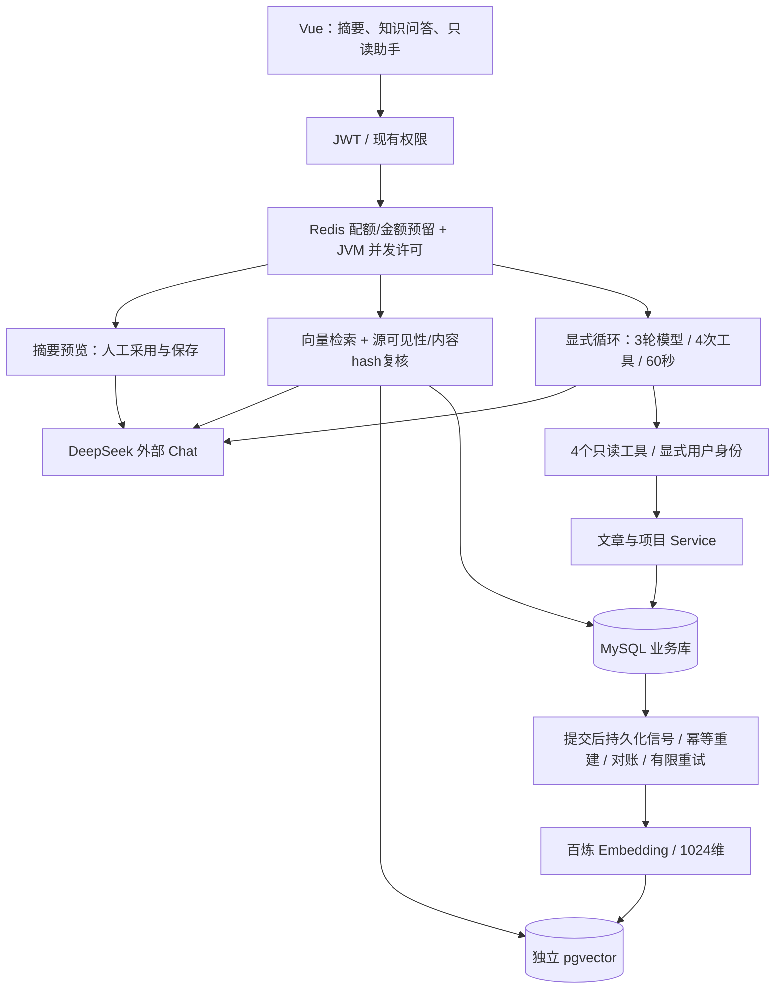

# AI 应用架构与设计决定

更新：2026-11-05。Java 21 / Spring Boot 3.5.16 / Spring AI 1.1.8；保持 MVC/Tomcat、MySQL、Vue3。开发验收与生产发布分开记录。

## 边界与取舍

- 摘要不写库；正文快照变化使旧结果失效，用户手动采用、保存。使用原文章管理权限，不虚构作者行权限。
- RAG仅取公开文章/项目。向量不是权限依据；发送模型前与返回答案前复核MySQL公开状态、hash、片段与活动版本。来源链接由后端构建。存在来源不等于语义正确，需要评测。
- 索引在业务事务提交后执行，外部服务失败不回滚已保存业务。新索引全部验证后才切换，失败保留旧指针；旧向量残留也必须过实时校验。V12增量同步表来自Day9；Day12—14不新增迁移，不改旧文件。
- Tool Workflow按固定步骤查业务，无Chat费用；Agent由模型选择工具，但后端逐项检查名称、schema、来源、身份与预算。详情只能读取本次搜索命中的公开ID。没有任意SQL、URL、写入、文件系统工具。
- 三个AI场景都不保留跨请求记忆。摘要与问答页面离开即清除，Agent每次独立执行。没有多Agent、长期记忆、MCP、Rerank、混合检索或训练。
- Chat使用独立有界Reactor Netty连接和线程，取消实际关闭上游；独立JDK客户端处理同步HTTP。向量独立Hikari最多2连接；原业务数据源不变。默认AI并发2，总时限60秒，摘要瞬态故障最多重试1次且仅在未输出前，RAG/Agent不自动重试Chat。
- Redis配额失败拒绝新付费调用；原JWT认证仍依赖Redis，因此不能声称Redis故障时登录正常。公开内容读接口在本轮故障测试中通过。
- RAG先完整校验后发送答案片段；Agent只在验证完成后发送done。心跳和提前收到meta不算首个有效答案。摘要则能看到真实供应商逐段输出。

## 本轮实际问题

1. Day11发现浏览器停止后JDK流式连接未及时关闭，改为有界Reactor Netty，保留真实TCP取消测试。
2. Day13初测中模型对删除请求正确拒绝执行，但返回answered=true并引用公开功能说明。补充RAG系统规则：操作、SQL、密钥、执行攻击指令请求统一无答案；原30题/两组配置复测通过。没有发生实际删除或泄密，RAG本身也没有工具。
3. Day14发现Nginx两处SSE引用不存在的命名错误页，同时Agent缺专用流式location。改用已有错误页，并为Agent设置HTTP/1.1、关闭缓冲和130秒读时限。实际隔离Nginx验证记录见执行报告。

仅为当前数据与环境提供证据，不声称通用防注入、生产容量或模型永不出错。

摘要由 AI_SUMMARY_ENABLED 独立控制，前置于配额与供应商调用；索引管理使用 ai:index:manage 权限（新增 V13）。供应商边界在每次实际 Chat/Embedding 调用前预留人民币估算金额，完整 usage 可得时结算，未知/失败/取消保留预留。日志及评测区分 null 和 0；不记录 Prompt/回答。详见 cost-and-data-policy.md。
